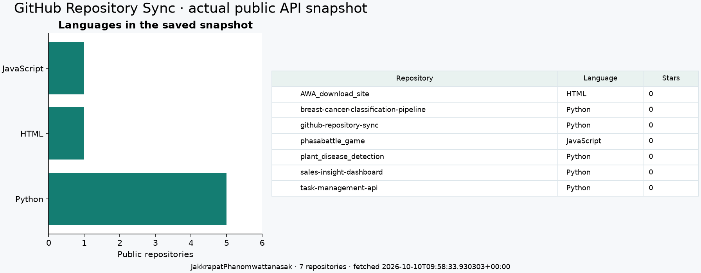
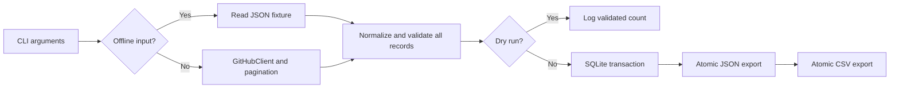

# GitHub Repository Sync — เรียน API Automation ตั้งแต่ศูนย์

คู่มือนี้อธิบาย repo `github-repository-sync` ตั้งแต่การส่ง HTTP request ไปจนถึง snapshot ใน SQLite และไฟล์ CSV/JSON โฟลเดอร์ในเครื่องปัจจุบันชื่อ `api-based-automation` เริ่มทดลองแบบ offline ได้โดยไม่ต้องมี GitHub token

## 1. ภาพรวมและผลลัพธ์ที่ต้องเห็น

ถ้าต้องเก็บรายการ public repositories ของผู้ใช้ GitHub ทุกวัน การเปิดหน้าเว็บแล้ว copy ด้วยมือทำซ้ำได้ยาก โปรแกรมนี้ทำกระบวนการให้เป็นคำสั่งเดียว: ดึงข้อมูลครบ → ตรวจและแปลงข้อมูล → บันทึก snapshot → export

Snapshot คือภาพข้อมูล ณ เวลาหนึ่ง เช่น repo ที่ยัง public, language และจำนวน stars เมื่อดึงครั้งนั้น ไม่ใช่ประวัติการเปลี่ยนแปลงทุกวัน เพราะโปรแกรมนี้เก็บ **สถานะล่าสุดต่อ owner** ใน DB



เมื่อเรียนจบควรดึงข้อมูลเอง อธิบาย retry กับ pagination ได้ ตรวจว่ารันซ้ำไม่เกิดแถวซ้ำ และอ่าน error โดยไม่เข้าใจผิดว่าดึงครบเสมอ

## 2. What / Why / How

| What | Why | How ในโค้ดนี้ |
|---|---|---|
| API integration | รับข้อมูลจากบริการอื่นแบบมีโครงสร้าง | Requests เรียก GitHub REST API |
| Pagination | API ส่งข้อมูลทีละหน้า | ขอครั้งละ 100 จนได้หน้าที่น้อยกว่า 100 |
| Timeout | ไม่ให้รอ connection/response ไม่สิ้นสุด | connect 5s, read 15s ต่อ attempt |
| Bounded retry | รับมือปัญหาชั่วคราวโดยไม่วนตลอด | default retry 3 ครั้ง พร้อม backoff |
| Schema validation | HTTP 200 ไม่ยืนยันว่าข้อมูลใช้ได้ | ตรวจทุก record ก่อน save |
| Normalization | เปลี่ยนชื่อ field ให้ใช้ในระบบง่าย | stargazers_count → stars |
| Idempotent snapshot | รันซ้ำไม่เพิ่มข้อมูลเดิมเป็นอีกแถว | transaction ลบ snapshot owner เดิมแล้ว INSERT ชุดใหม่ |
| Atomic export | ไม่ให้ไฟล์ปลายทางค้างเป็นครึ่งไฟล์ | เขียน temporary file แล้ว `os.replace()` |

## 3. พื้นฐานก่อนเขียน automation

**API** เป็นข้อตกลงการรับส่งข้อมูลของโปรแกรม เราใช้ endpoint นี้:

```text
GET https://api.github.com/users/{username}/repos
```

`username` คือ path parameter ส่วน `?per_page=100&page=1` เป็น query parameters และ header เช่น `Accept` บอกชนิดข้อมูลที่ขอ Response มี HTTP status กับ body JSON

ตัวอย่าง JSON แบบย่อเพื่ออธิบายโครงสร้าง ไม่ใช่ข้อมูลครบที่ validator รับ:

```json
[
  {"id": 1, "name": "example-project", "language": "Python"}
]
```

ใน Python outer structure นี้คือ `list` สมาชิกแต่ละตัวเป็น `dict` เช่น `item["name"]` อ่านชื่อ repo และ `None` แทน JSON `null` เช่นบาง repo ไม่มี language หลัก

**CLI** คือโปรแกรมที่เรียกจาก terminal เช่น `python -m api_automation.cli --username demo` คำหลัง `--` เป็น argument ที่ `argparse` อ่านเข้ามา **Automation** คือทำลำดับงานซ้ำอย่างเป็นระบบ ไม่จำเป็นต้องมี AI หรือเปิด browser ควบคุมเมาส์

Python ที่ควรรู้สำหรับอ่านโค้ดนี้: `for` วนหลายหน้า, `if` เลือกตาม status, function แบ่งหน้าที่, class เก็บ session/settings และ `try/except/finally` ใช้รับมือ error พร้อมปิด resource แม้ทำไม่สำเร็จ

## 4. เครื่องมือและแผนที่ source

| เครื่องมือ/ไฟล์ | ใช้ทำอะไร |
|---|---|
| Python | CLI และลำดับ automation |
| Requests | HTTP session, headers และ timeout |
| `argparse` | อ่าน CLI arguments |
| `json` / `csv` | อ่านและเขียนไฟล์ข้อมูล |
| `sqlite3` | เก็บ snapshot เป็นตาราง |
| `logging` | แสดง outcome และ retry โดยไม่พิมพ์ token |
| `tempfile` / `os.replace` | แทน export file เมื่อเขียนเสร็จ |
| pytest / `unittest.mock` | ทดสอบ network failures แบบไม่ยิง API จริง |
| Git / GitHub | เก็บ source; GitHub เป็นแหล่ง public API ด้วย |
| `src/api_automation/cli.py` | `main()` รับ argument และเชื่อมทุกขั้น |
| `src/api_automation/client.py` | ดึงหน้าและจัดการ timeout/retry |
| `src/api_automation/storage.py` | `normalize()`, `save_snapshot()`, `_atomic_write()` |
| `examples/github_response.json` | fixture สังเคราะห์สำหรับทดลอง offline |
| `tests/test_sync.py` | ตรวจ pagination, failures, persistence และ dry-run |

Fixture คือ input ตัวอย่างที่ควบคุมไว้เพื่อให้ทดลองซ้ำได้ ไม่ใช่การแกล้งทำให้เหมือนมีการดึง GitHub จริง ส่วนภาพในหัวคู่มือนี้มาจากการรัน API จริงและมี fetch timestamp ของมัน

## 5. Step by step: ติดตั้งแล้วเริ่มแบบ offline

### ขั้นที่ 1 — เข้า repo

จาก `ProfileProject`:

```powershell
Set-Location .\api-based-automation
python --version
python -m venv .venv
.\.venv\Scripts\python.exe -m pip install -e ".[dev]"
```

ใช้ Python 3.11+ ถ้า clone ใหม่ให้เข้า `github-repository-sync` แทน `.venv` แยก dependency ของโปรเจกต์ `pip install -e` ทำให้ import source ได้ และ `[dev]` เพิ่มเครื่องมือทดสอบ

เครื่องนี้มี environment ร่วมใน `ProfileProject/.venv` แล้ว ถ้าใช้ตัวนั้น เปลี่ยน `.\.venv\Scripts\python.exe` เป็น `..\.venv\Scripts\python.exe` หลังเข้า repo โดยข้ามการสร้าง/ติดตั้งซ้ำ

### ขั้นที่ 2 — อ่าน fixture ก่อน

```powershell
Get-Content .\examples\github_response.json
```

จะเห็น list หนึ่ง record ที่ owner คือ `demo` ชื่อ `example-project` มี ID, stars, forks, language, timestamp และ URL ข้อมูลนี้สังเคราะห์ขึ้นเพื่อสอน format

### ขั้นที่ 3 — ทดลอง dry-run

```powershell
.\.venv\Scripts\python.exe -m api_automation.cli --username demo --input examples/github_response.json --output output --dry-run
```

ควรเห็น log `Validated 1 repositories for demo` dry-run ตรวจข้อมูลแต่ไม่สร้าง/แก้ export หรือ DB หาก `output` มีอยู่ก่อนแล้ว มันก็ยังอยู่ ไม่ใช่ว่า dry-run ลบไฟล์เดิม

### ขั้นที่ 4 — บันทึกจริงจาก fixture

```powershell
.\.venv\Scripts\python.exe -m api_automation.cli --username demo --input examples/github_response.json --output output
Get-ChildItem .\output
Get-Content .\output\repositories.json
Import-Csv .\output\repositories.csv | Format-Table
```

ควรเห็น `Saved 1 repositories for demo` และสามไฟล์:

| Output | จุดประสงค์ |
|---|---|
| repositories.db | ตารางสำหรับ query และ persistence |
| repositories.json | metadata เช่น username/time/count พร้อม records |
| repositories.csv | ตารางเรียบสำหรับ Excel/Pandas |

### ขั้นที่ 5 — รันซ้ำแล้วตรวจ DB

รันคำสั่ง save อีกครั้ง แล้วตรวจจำนวนแถวของ owner demo:

```powershell
@'
import sqlite3
connection = sqlite3.connect("output/repositories.db")
try:
    count = connection.execute(
        "SELECT count(*) FROM repositories WHERE owner = ?", ("demo",)
    ).fetchone()[0]
    print("demo rows:", count)
finally:
    connection.close()
'@ | .\.venv\Scripts\python.exe -
```

ควรได้หนึ่งแถวไม่ใช่สอง นี่คือการตรวจ idempotency ด้านจำนวน/เนื้อหา record ไม่ใช่ว่า JSON ทั้งไฟล์จะเหมือนทุก byte เพราะ `fetched_at` เปลี่ยนตามการรันจริง

## 6. Step by step: เรียก GitHub API จริง

```powershell
.\.venv\Scripts\python.exe -m api_automation.cli --username JakkrapatPhanomwattanasak --output output/live
Get-Content .\output\live\repositories.json
```

ครั้งนี้ **ไม่ส่ง `--input`** จึงเรียก network จริง จำนวน repo อาจเปลี่ยนตามบัญชีและเวลาที่ดึง ไม่ควรคาดว่าต้องเป็นเจ็ดตลอด ผลลัพธ์ดึงเฉพาะ public repositories ตาม endpoint นี้

ตัวอย่างอื่น:

```powershell
# ดึงและตรวจจริง แต่ไม่บันทึก
.\.venv\Scripts\python.exe -m api_automation.cli --username JakkrapatPhanomwattanasak --dry-run

# เปลี่ยนเพดาน pagination เป็น 30 หน้า
.\.venv\Scripts\python.exe -m api_automation.cli --username JakkrapatPhanomwattanasak --output output/live --max-pages 30
```

Token ไม่จำเป็นสำหรับทดลอง public data แบบพื้นฐาน แต่ GitHub มี rate limits ตัวโปรแกรมรองรับ `GITHUB_TOKEN` ผ่าน environment ของ process หากต้องการ authentication ไม่ได้อ่าน token จาก command argument หรือไฟล์ source และไม่บันทึกมันลง exports

Git credential ที่ใช้ `git push` กับ `GITHUB_TOKEN` ที่ CLI นี้อ่านเป็นคนละช่องทาง การ login Git สำเร็จไม่ได้แปลว่า script นี้ได้รับ token โดยอัตโนมัติ

## 7. ตามโค้ดตั้งแต่ input ถึง output



### 7.1 `main()` เลือกเส้นทาง

`argparse` อ่าน username/output/input/max-pages/dry-run แล้วตรวจ username ก่อนเริ่ม ข้อมูล offline กับ network ถูกส่งเข้า `normalize()` เหมือนกัน หลัง validate สำเร็จจึงเลือกว่าจะ save หรือแค่ log

`finally: client.close()` ปิด session แม้ fetch ล้มเหลว และ `raise SystemExit(main())` ทำให้โปรแกรมคืน exit code ให้ terminal/scheduler: 0 สำเร็จ, 1 คือ failure ที่ CLI จับและรายงานไว้ ส่วน argument syntax ที่ argparse ปฏิเสธมี exit code ของ argparse เอง

### 7.2 Session, headers และ timeout

Requests Session เก็บ headers และ reuse connections โค้ดตั้ง Accept, User-Agent และ API version header ส่วน Authorization เพิ่มเฉพาะเมื่อมี token

`timeout=(5,15)` แยก connect timeout กับ read timeout **ไม่ใช่เส้นตายว่าทั้งงานต้องจบใน 20 วินาที** เพราะมีหลาย request, retries และ backoff ได้ read timeout ก็ไม่ได้เป็นงบเวลารวมการ download ทั้งไฟล์

โค้ดใช้ host `api.github.com` ที่กำหนดไว้และไม่ตาม redirects อัตโนมัติ ไม่รับ URL ปลายทางอิสระจากผู้ใช้

### 7.3 Pagination: หยุดเมื่อใด

ขอหน้า 1, 2, 3 … ครั้งละ 100 records ถ้าหน้าใดมีน้อยกว่า 100 ถือว่าสุดท้ายตามวิธีของ client นี้ ดังนั้นบัญชีที่มี **exactly 100** repo จะต้องขอหน้า 2 ที่ว่างเพื่อยืนยันว่าครบ

default `max_pages=20` และอนุญาต 1–100 หากถึงเพดานแต่หน้าสุดท้ายยังเต็ม จะ raise error และไม่ save snapshot ที่อาจไม่ครบ เหตุผลคือการ save partial snapshot อาจทำให้ repo ที่ยังมีจริงแต่ไม่ได้ดึงมาถูกลบจาก DB

### 7.4 Retry: อะไรควรลองใหม่

| เหตุการณ์ | พฤติกรรม |
|---|---|
| Timeout / connection failure | retry ภายใน budget |
| 500 / 502 / 503 / 504 | ปัญหาชั่วคราวฝั่ง service จึง retry |
| 429 หรือ 403 ที่แสดง rate limiting | พิจารณา Retry-After / หยุดเพื่อรันใหม่ภายหลัง |
| 401 / 404 และ HTTP error ถาวรอื่น | หยุดทันที |
| HTTP 200 แต่ JSON/schema ผิด | หยุด ไม่ถือว่า success |

default retries = 3 หมายถึง **attempt แรก + retry ได้สามครั้ง รวมสูงสุดสี่ attempts ต่อหน้า** backoff ปกติรอ 1, 2, 4 วินาที ตาม `2 ** attempt`

ถ้ามี numeric Retry-After โค้ดรออย่างน้อยตาม header ภายในขอบเขต ถ้าค่านานกว่า 30 วินาที หรือ primary rate limit หมดโดยไม่มีเวลารอสั้นที่ใช้ได้ จะ fail เพื่อให้รันใหม่ภายหลัง ไม่ทำ loop รอหลายชั่วโมง

โค้ดรองรับ Retry-After แบบตัวเลข ยังไม่ parse รูปแบบ HTTP-date และไม่มี jitter ข้อจำกัดนี้ควรรู้ก่อนใช้กับ API อื่น

### 7.5 Normalize และ validate

`normalize()` ตรวจว่า input เป็น list และสมาชิกเป็น object จากนั้นตรวจ ID เป็น integer บวก stars/forks เป็น integer ไม่ติดลบ owner และ GitHub URL ต้องตรงกับ username และ full_name รวมถึง language/timestamp ถูกชนิด

ทำไมต้องกัน `bool` ออกจาก integer? เพราะใน Python `bool` เป็น subclass ของ `int` ถ้าเช็กแต่ `isinstance(value, int)` ค่า True อาจผ่านเป็น ID ได้

ชื่อ field ถูกลดเป็น `stars`/`forks` และเก็บ record ตาม ID เพื่อตัด duplicates ถ้า ID ซ้ำและข้อมูลเหมือนกันยอมรับได้ แต่ถ้า ID เดียวกันข้อมูลต่างกันจะหยุดเพื่อ retry snapshot แทนการเลือกอันใดอันหนึ่งเงียบ ๆ

### 7.6 SQLite transaction

ภายใน transaction โค้ดลบแถวของ owner ที่กำลัง sync แล้ว INSERT ชุดครบที่ validate แล้ว ดังนั้น repo ที่ไม่ได้อยู่ในผลล่าสุดจะหายจาก snapshot owner นั้น การลบ/เพิ่มต้องสำเร็จด้วยกัน ไม่ทิ้ง DB ว่างหากเกิด error ระหว่าง INSERT

นี่เป็น **replace snapshot** ไม่ใช่ update เฉพาะ row ที่เปลี่ยน และไม่ใช่การเก็บ history ทุกครั้ง owner คนอื่นไม่ถูกลบ แต่ ID เป็น primary key ของตารางรวม การย้าย repository ระหว่าง owner ที่เก็บไว้ใน DB เดียวอาจเจอ ID conflict ต้องเพิ่ม reconciliation หากจะรองรับกรณีนั้น

### 7.7 Atomic export

`_atomic_write()` เขียนไฟล์ชั่วคราวใน directory เดียวกับปลายทาง ปิดไฟล์ แล้ว `os.replace()` แทนไฟล์เดิม ผู้ใช้จึงไม่ควรเห็นไฟล์ปลายทางเป็นข้อมูลที่เขียนได้ครึ่งเดียว

แต่ transaction นี้ครอบคลุม **DB เท่านั้น** และ replacement เป็น atomic **ทีละไฟล์** ไม่ได้ครอบคลุม DB + JSON + CSV พร้อมกัน DB commit ก่อน export ถ้า disk error ตอนเขียน CSV อาจมี DB/JSON ใหม่แต่ CSV เก่า ต้องแก้ storage แล้ว rerun เพื่อ reconcile ไม่ควรอ้างว่า output ทุกชนิด all-or-nothing

## 8. Logs, scheduling และเว็บไซต์จริง

Logs บอก outcome/count และการ retry ทำให้ตรวจงานที่รัน unattended ได้ การ log ทุก response รวม token จะเพิ่มความเสี่ยงโดยไม่ช่วยงานนี้ โปรแกรมจึงไม่ได้พิมพ์ Authorization header

หากต้องการทำทุกวัน ต้องตั้ง Windows Task Scheduler ภายนอกโดยใช้ path Python, working directory และ output path ที่แน่นอน พร้อมตรวจ exit code/logs **repo นี้ยังไม่ได้ติดตั้ง scheduled task** การเป็น CLI automation ไม่ได้แปลว่ามี scheduler ทำงานอยู่แล้ว

[เว็บสาธารณะ](https://jakkrapat-project-lab.happy-bud-2264.chatgpt.site/#sync) เป็น browser client ที่เรียก public GitHub API และดาวน์โหลด CSV/JSON ส่วน SQLite persistence และ workflow ของ Python อยู่ใน CLI เว็บนี้ไม่ได้สร้าง DB บน server ให้ visitor แต่ละคน

ใช้ output folder แยกเมื่ออยากเก็บ exports ของหลาย username เพราะ DB แยก owner ได้แต่ JSON/CSV ใน folder เดียวถูกแทนด้วยผู้ใช้ที่รันล่าสุด ระบบนี้ออกแบบให้รันตามลำดับ ไม่รับประกัน concurrent writers หรือ snapshot ที่คงที่ขณะ GitHub กำลังเปลี่ยนข้อมูลระหว่าง pagination

## 9. ทดสอบแบบไม่ต้องยิง API จริง

```powershell
.\.venv\Scripts\python.exe -m pytest -q
.\.venv\Scripts\ruff.exe check .
.\.venv\Scripts\ruff.exe format --check .
```

เวอร์ชันที่บันทึกไว้มี 14 test cases `Mock` จำลอง Session/Response ส่วน `sleep=Mock()` ตรวจว่ามีการรอโดยไม่ต้องรอจริง เช่นเทสต์ตอบ 503 → หน้า 100 records → หน้า 1 record แล้วตรวจว่าดึงได้ 101 records และ retry หนึ่งครั้ง

Tests ตรวจ malformed JSON, permanent error, rate limiting, schema, dry-run, rerun ไม่ซ้ำ และ stale-record removal ช่วยทดสอบกรณี network failure ที่เรียก API จริงแล้วบังคับให้เกิดได้ยาก ส่วน live smoke test ยังจำเป็นสำหรับตรวจ integration จริง แต่ไม่ได้แทน mocked tests

## 10. Troubleshooting

| อาการ | ตรวจและแก้อย่างไร |
|---|---|
| import `api_automation` ไม่ได้ | อยู่ใน repo และใช้ Python environment ที่ติดตั้งแพ็กเกจแล้ว |
| offline owner mismatch | fixture มี owner demo ต้องใช้ `--username demo` |
| 404 | ตรวจ username; ไม่ใช่เหตุให้ retry ไม่สิ้นสุด |
| 401 | ตรวจ token ที่ตั้งใน environment; ไม่ส่ง token ลงแชตหรือ source |
| rate limited | อ่าน log แล้วรันใหม่ภายหลังตามข้อจำกัด service |
| Pagination limit reached | ใช้ max-pages ที่เหมาะสม; ไม่ save ผลบางส่วนทับ snapshot เดิม |
| JSON/CSV ไม่ตรง DB หลัง failure | ตรวจ disk/สิทธิ์เขียนและ rerun เพราะ export ไม่อยู่ใน DB transaction |
| CSV ของ owner ก่อนหน้าหาย | export folder เดียวเก็บผู้ใช้ล่าสุด ให้แยก output folders |

## 11. แบบฝึกหัดและคำถามตรวจความเข้าใจ

1. รัน fixture สองครั้งแล้ว query row count → ต้องยังมีหนึ่งแถวต่อ ID
2. ทำสำเนา fixture แล้วเปลี่ยน stars เป็น -1 → ควร fail ก่อน save โดย snapshot เดิมยังอยู่
3. ทำ offline fixture สอง repos แล้วเปลี่ยนเหลือหนึ่ง → แถวที่หายต้องถูกเอาออกจาก snapshot owner นั้น
4. ออกแบบ mocked responses ที่มี 100/100/5 records → ต้องขอสามหน้าและรวมได้ 205
5. เพิ่ม field `archived` → ต้องแก้ normalization, DB schema, export และ tests ไม่ใช่เพิ่ม column ใน CSV อย่างเดียว
6. เพิ่ม snapshot history → ต้องออกแบบ run ID/timestamp และ retention เป็นความสามารถใหม่ ยังไม่มีในโค้ดนี้

- HTTP 200 แปลว่าบันทึกข้อมูลสำเร็จหรือไม่? **ยังไม่ใช่ ต้อง parse, validate, write DB และ export สำเร็จด้วย**
- ทำไม retry สามครั้งอาจยิงสี่ครั้ง? **attempt แรกไม่นับเป็น retry**
- ทำไม dry-run ยังเรียก API ได้? **มันงดการเขียน output ไม่ได้งด fetch; ใช้ --input หากต้องการ offline**
- ทำไมข้อมูลมี timestamp ใหม่แต่ยังเรียก idempotent? **record state ไม่เพิ่มซ้ำตาม ID แต่ metadata การรันเปลี่ยนได้**
- ทำไมไม่จับ error แล้วคืน list ว่างทันที? **จะทำให้ failure ถูกตีความเป็น snapshot ว่างและอาจลบข้อมูลเดิมผิด ๆ**

ถือว่าเข้าใจเมื่อคุณชี้ได้ว่า failure แต่ละจุดกระทบ output ไหน และทำให้การรันซ้ำแก้ปัญหาได้อย่างไร โดยไม่พูดว่า “มี retry เลยไม่มีวันล้มเหลว”

## 12. เอกสารอ่านต่อ

- [GitHub REST: list repositories for a user](https://docs.github.com/en/rest/repos/repos#list-repositories-for-a-user)
- [GitHub API best practices](https://docs.github.com/en/rest/using-the-rest-api/best-practices-for-using-the-rest-api)
- [Requests Advanced Usage](https://requests.readthedocs.io/en/latest/user/advanced/)
- [Python sqlite3](https://docs.python.org/3/library/sqlite3.html)
- [README ของโปรเจกต์](../README.md)
